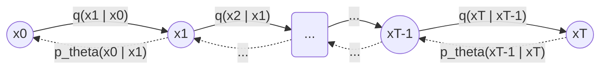
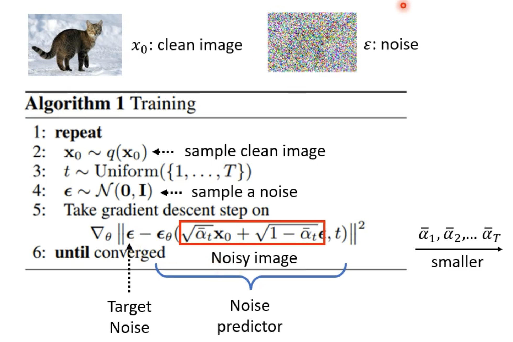
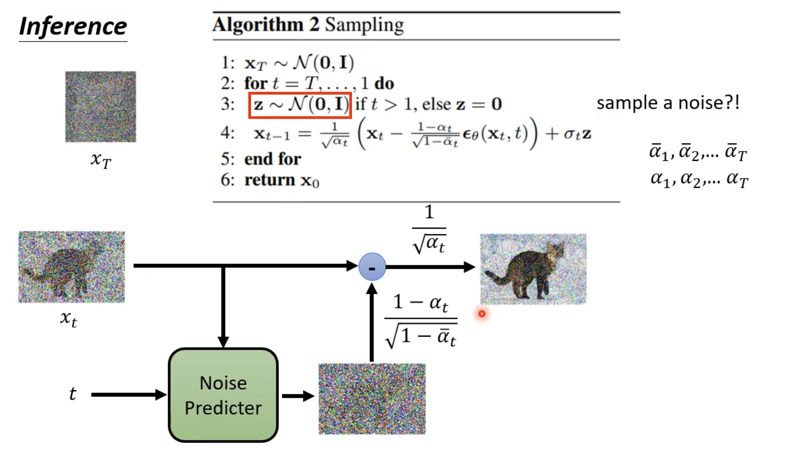
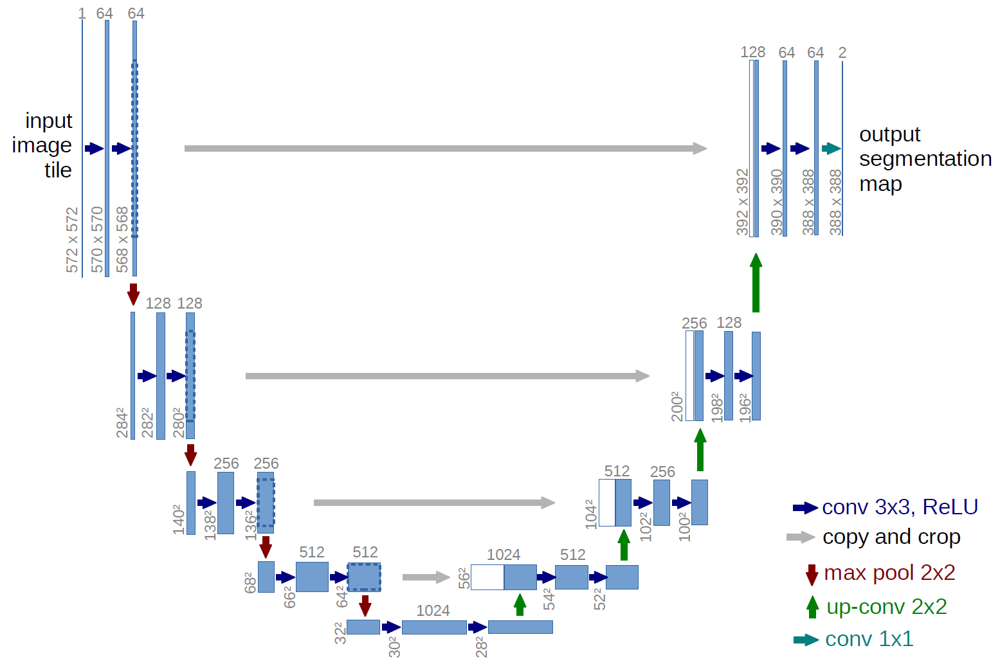

# Diffusion Model Study Notes

## The Diffusion Process

To understand diffusion, set the inputs aside for now and start with the first problem: how can a model, with no extra input (text, image), generate an image in the same style as the training set through a diffusion process?

Solid black arrows (→) are the forward process (adding noise; fixed, no parameters); dashed arrows (-.→) are the reverse process (denoising, predicted by the network εθ).

### Forward process

In plain words, the forward process keeps adding noise to an original image $x_0$ until it becomes a completely blurred image $x_T$.

Single-step noising (a Markov chain; each step depends only on the previous one):

$$
q(x_t \mid x_{t-1}) = \mathcal{N}\left(x_t; \sqrt{1-\beta_t}\, x_{t-1},\ \beta_t I\right)
$$

where $\beta_t \in (0,1)$ is the noise strength at step $t$ (the noise schedule).

Closed form for an arbitrary step (you can jump from $x_0$ straight to $x_t$ without sampling step by step):

$$
q(x_t \mid x_0) = \mathcal{N}\left(x_t; \sqrt{\bar\alpha_t}\, x_0,\ (1-\bar\alpha_t) I\right)
$$

where $\alpha_t = 1-\beta_t$ and $\bar\alpha_t = \prod_{s=1}^{t} \alpha_s$.

### Another view: reparameterization

$q(x_t \mid x_{t-1})$ is a normal distribution, which is equivalent to first sampling a noise $\epsilon$ from a standard normal and then applying a linear transformation:

$$
x_t = \sqrt{\alpha_t}\, x_{t-1} + \sqrt{1-\alpha_t}\, \epsilon, \qquad \epsilon \sim \mathcal{N}(0, I)
$$

(Here $\alpha_t = 1-\beta_t$.) This is the "reparameterization trick": rewrite "sampling from a distribution" as "sample noise from a fixed distribution, then apply a deterministic transformation". The benefit is that the whole process is differentiable with respect to the parameters, and it is also more intuitive: each step just shrinks the previous image a little and adds a little noise.

Likewise, the closed form $q(x_t \mid x_0)$ can be written in the same form:

$$
x_t = \sqrt{\bar\alpha_t}\, x_0 + \sqrt{1-\bar\alpha_t}\, \epsilon, \qquad \epsilon \sim \mathcal{N}(0, I)
$$

### Exercise: prove why we can jump from $x_0$ directly to $x_t$

**Problem**: Given the single-step noising $x_t = \sqrt{\alpha_t}\, x_{t-1} + \sqrt{1-\alpha_t}\, \epsilon_t$ (the $\epsilon_t$ of the different steps are independent and each follows $\mathcal{N}(0,I)$), prove that

$$
x_t = \sqrt{\bar\alpha_t}\, x_0 + \sqrt{1-\bar\alpha_t}\, \epsilon, \qquad \epsilon \sim \mathcal{N}(0, I),\quad \bar\alpha_t = \prod_{s=1}^t \alpha_s
$$

**Hint**: Use induction. The key is the property that "a linear combination of two independent Gaussian variables is still Gaussian": if $\epsilon_1, \epsilon_2 \sim \mathcal{N}(0,I)$ are independent, then $a\epsilon_1 + b\epsilon_2 \sim \mathcal{N}(0, (a^2+b^2)I)$, which can be merged into a new $\epsilon \sim \mathcal{N}(0,I)$ multiplied by the coefficient $\sqrt{a^2+b^2}$.

**Proof**:

- Base case ($t=1$): $x_1 = \sqrt{\alpha_1}\,x_0 + \sqrt{1-\alpha_1}\,\epsilon_1$. Here $\bar\alpha_1 = \alpha_1$, so the claim holds.
- Inductive hypothesis: suppose $x_{t-1} = \sqrt{\bar\alpha_{t-1}}\, x_0 + \sqrt{1-\bar\alpha_{t-1}}\, \bar\epsilon_{t-1}$, where $\bar\epsilon_{t-1} \sim \mathcal{N}(0,I)$.
- Inductive step: substitute it into the single-step formula

$$
\begin{aligned}
x_t &= \sqrt{\alpha_t}\, x_{t-1} + \sqrt{1-\alpha_t}\, \epsilon_t \\
&= \sqrt{\alpha_t}\left(\sqrt{\bar\alpha_{t-1}}\, x_0 + \sqrt{1-\bar\alpha_{t-1}}\, \bar\epsilon_{t-1}\right) + \sqrt{1-\alpha_t}\, \epsilon_t \\
&= \sqrt{\alpha_t \bar\alpha_{t-1}}\, x_0 + \underbrace{\sqrt{\alpha_t(1-\bar\alpha_{t-1})}\, \bar\epsilon_{t-1} + \sqrt{1-\alpha_t}\, \epsilon_t}_{\text{linear combination of two independent Gaussians}}
\end{aligned}
$$

Since $\bar\epsilon_{t-1}$ and $\epsilon_t$ are independent, their linear combination is still Gaussian, and its variance is the sum of the squared coefficients:

$$
\alpha_t(1-\bar\alpha_{t-1}) + (1-\alpha_t) = \alpha_t - \alpha_t\bar\alpha_{t-1} + 1 - \alpha_t = 1 - \alpha_t\bar\alpha_{t-1} = 1-\bar\alpha_t
$$

So the two terms can be merged into a single new $\epsilon \sim \mathcal{N}(0,I)$:

$$
x_t = \sqrt{\alpha_t\bar\alpha_{t-1}}\, x_0 + \sqrt{1-\bar\alpha_t}\, \epsilon = \sqrt{\bar\alpha_t}\, x_0 + \sqrt{1-\bar\alpha_t}\, \epsilon
$$

(using $\bar\alpha_t = \alpha_t \bar\alpha_{t-1}$). By induction, the claim holds for all $t$. ∎

**Intuition**: every noising step adds "independent" Gaussian noise, and stacking many steps still gives a Gaussian (Gaussians are closed under linear combinations). So the noise from $t$ steps can be "pre-merged" into one equivalent single-step noise, and we can sample $x_t$ directly from $x_0$ without actually running $t$ iterations.

### Reverse Process

The reverse process is the harder part to understand, but the intuition is simple: how do we find the optimal parameters $p_\theta$ that recover $x_0$ with the highest probability, i.e.

$$
p_\theta(x_{t-1} \mid x_t), \qquad \theta^* = \arg\max_{\theta} \log p_\theta(x_0)
$$

#### Probability basics (review)

For a joint distribution $p_{X,Y}(x,y)$ and an event $B$:

$$
P_{X,Y}(B) = \sum_{(x,y) \in B} p_{X,Y}(x,y) \qquad \text{(discrete)}
$$

$$
P_{X,Y}(B) = \iint_{(x,y) \in B} p_{X,Y}(x,y)\, dx\, dy \qquad \text{(continuous)}
$$

If $X$ and $Y$ are independent:

$$
p(x \mid y) = p(x) \iff p(y \mid x) = p(y)
$$

The marginal distribution is a special consequence of the joint distribution. Given $p_{X,Y}$, to get $p_X(x)$:

$$
p_X(x) = \sum_{y} p_{X,Y}(x,y) \qquad \text{(discrete)}
$$

$$
p_X(x) = \int p_{X,Y}(x,y)\, dy \qquad \text{(continuous)}
$$

#### Reverse process

The job of the reverse process is to find a set of parameters $p_\theta$ that maximizes the probability $p(x_0)$:

$$
p(x_0, x_1, x_2, \ldots, x_t) = p(x_0, x_{1:t}) = p(x_0)\, p(x_1 \mid x_0)\, p(x_2 \mid x_1) \cdots p(x_{t-1} \mid x_t)
$$

$$
p(x_0) = \int p(x_0, x_{1:T})\, dx_{1:T}
$$

Unfortunately, the integral above is intractable (it cannot be computed analytically).

#### A series of magical mathematical transformations

This part is time-consuming and a bit too brain-burning, so I'll skip it for now. The rough idea: use a mathematical transformation to turn the formula above into an expectation, apply Jensen's inequality to get a lower bound (the ELBO), and then optimize that lower bound with variational inference.

#### Loss function

Skipping the details of the ELBO derivation, the training objective DDPM ends up using is a very simple mean squared error (the "simple loss"):

$$
L_{\text{simple}}(\theta) = \mathbb{E}_{t,\, x_0,\, \epsilon}\Big[\ \|\epsilon - \epsilon_\theta(x_t, t)\|^2\ \Big], \qquad x_t = \sqrt{\bar\alpha_t}\, x_0 + \sqrt{1-\bar\alpha_t}\, \epsilon
$$

What each term means:

- $\theta$: the trainable weights of the neural network.
- $t$: the timestep, sampled at random from $1$ to $T$ during training.
- $x_0$: a real image drawn at random from the training set.
- $\epsilon$: Gaussian noise sampled on the spot, $\epsilon \sim \mathcal{N}(0, I)$; it is the "ground truth" the model has to guess.
- $\bar\alpha_t$: a constant precomputed from the noise schedule; it depends only on $t$ and is not learned.
- $x_t$: the "noised image" obtained by mixing $x_0$ and $\epsilon$ in the proportions given by $\bar\alpha_t$.
- $\epsilon_\theta(x_t, t)$: the network's output; given the noised image $x_t$ and the timestep $t$, it outputs the noise the network thinks was added.
- $\|\cdot\|^2$: the squared L2 norm, i.e. mean squared error (MSE).

Training procedure: pick a random image, a random timestep, and a random draw of noise, and mix them into $x_t$; the network sees $x_t$ and $t$ and guesses which noise was added; the mean squared error between the guessed noise and the true noise is the loss, and backpropagation updates $\theta$.

#### Sampling formula for the reverse process

The true posterior $q(x_{t-1}\mid x_t, x_0)$ is Gaussian, with mean and variance:

$$
\tilde\mu_t(x_t,x_0) = \frac{\sqrt{\bar\alpha_{t-1}}\,\beta_t}{1-\bar\alpha_t}\, x_0 + \frac{\sqrt{\alpha_t}\,(1-\bar\alpha_{t-1})}{1-\bar\alpha_t}\, x_t, \qquad \tilde\beta_t = \frac{1-\bar\alpha_{t-1}}{1-\bar\alpha_t}\,\beta_t
$$

At inference time there is no $x_0$, so we plug in the estimate obtained by inverting the reparameterization formula:

$$
\hat{x}_0 = \frac{1}{\sqrt{\bar\alpha_t}}\left(x_t - \sqrt{1-\bar\alpha_t}\,\epsilon_\theta(x_t,t)\right)
$$

After substituting and simplifying, the model's mean is parameterized as:

$$
\mu_\theta(x_t, t) = \frac{1}{\sqrt{\alpha_t}}\left(x_t - \frac{\beta_t}{\sqrt{1-\bar\alpha_t}}\, \epsilon_\theta(x_t, t)\right)
$$

The per-step sampling formula (start from $x_T \sim \mathcal{N}(0,I)$ and iterate $t=T,\ldots,1$ down to $x_0$):

$$
x_{t-1} = \frac{1}{\sqrt{\alpha_t}}\left(x_t - \frac{\beta_t}{\sqrt{1-\bar\alpha_t}}\, \epsilon_\theta(x_t, t)\right) + \sigma_t z, \qquad z \sim \mathcal{N}(0,I)\ (\text{noise added when } t>1,\ \text{none when } t=1),\quad \sigma_t^2 = \beta_t \text{ or } \tilde\beta_t
$$

## Training and Sampling Algorithm

DDPM training algorithm. Reference: Hung-yi Lee ML 2023 course, https://speech.ee.ntu.edu.tw/~hylee/ml/ml2023-course-data/DDPM%20(v7).pdf

DDPM sampling algorithm. Reference: Hung-yi Lee ML 2023 course, https://speech.ee.ntu.edu.tw/~hylee/ml/ml2023-course-data/DDPM%20(v7).pdf

## U-Net

TODO

